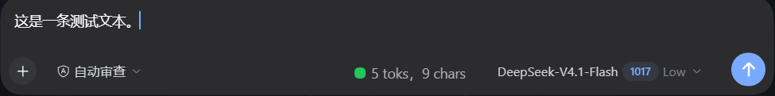

# dsh-tokenizer

> **自用插件**（personal use）。按需取用，不保证适配所有 DSH 版本；出问题以你的环境为准。

一个自制的小插件：在 DSH 输入框旁显示**这条草稿的较精确的 token 数**（不是估算）。
约 **160 字变黄**，约 **800 字变红**；变红基本意味着你可能粘贴了太多东西。
词表随插件打包，离线可用。



<sub>截图里是 `<tokens> toks，<chars> chars`：前者是本条草稿的 token 数，后者是字符数。</sub>

## 原理

- host 端读取包内 `assets/tokenizer.json`（官方 DeepSeek V4 词表 + `tokenizer_config.json`），
  暴露本地接口：

  ```
  POST /dsh-tokenizer/count
  { "text": "你好，世界" }
  -> { "ok": true, "value": { "tokens": 3, "chars": 5 } }
  ```

- client 端在草稿变化 500ms 后请求这个接口，在 `conversation.input.right` 席位显示
  彩色圆点 + `N toks，M strs`。阈值在 `lib/client.js` 顶部的 `GREEN_MAX` / `YELLOW_MAX`：
  <100 绿、100–500 黄、≥500 红。按本词表约 1.5–1.7 字/token 换算，500 大致是 800 汉字，
  也就是"你粘了一大段"的分界（草稿离模型窗口还很远，红灯是提醒，不是容量告警）。

## 为什么不走 Python

官方 `deepseek_tokenizer.py` 第一行是 `import transformers`，等于要求用户先
`pip install transformers`（100 MB 起），还要维护一个常驻子进程。而
`@huggingface/tokenizers`（0.3 MB，核心 mjs 80 KB）能直接读同一份 `tokenizer.json`，
在 Node 里同步算完。本插件选后者。

## 依赖

| 依赖 | 版本 | 说明 |
| --- | --- | --- |
| `@huggingface/tokenizers` | **0.1.3（锁定）** | 读 `tokenizer.json` 并执行 BPE |
| `react` | `^18.2.0` | 由 DSH 页面提供（peer） |

词表不是依赖，是包内资产：`assets/tokenizer.json`（约 6 MB）+ `assets/tokenizer_config.json`。

## 换词表

默认用包内的。要换成别的版本，在 profile 的 patch 里给这一行加配置即可：

```yaml
- insert:
    - id: dsh-tokenizer
      name: 'dsh-tokenizer'
      config:
        tokenizerPath: 'D:/somewhere/deepseek_vX_tokenizer/tokenizer.json'
```

`tokenizer_config.json` 从同一个目录读取。文件缺失时插件会带着完整路径报错，不会静默降级。

## 安装

**从 GitHub（当前可用）：**

```sh
dsh plugin --profile <profile> add https://github.com/2522669008-zcy/dsh-tokenizer
```

**从本地目录：**

```sh
dsh plugin --profile <profile> add <本仓库的绝对路径>
```

两种方式都会按 `package.json` 的 `dependencies` 自动安装依赖；仓库里没有 `node_modules`
是正常的。确认 profile 的 `dsh.profile.bundles` 里有 `dsh-tokenizer`。

> npm 上还没有发布（`dsh-tokenizer` 这个名字仍空着）。发布之后才能用
> `dsh plugin --profile <profile> add dsh-tokenizer`；`package.json` 里已经预置了
> `publishConfig`，指向官方源。

装完刷新页面即可（客户端改动只需刷新，不用重启应用）。

## 验证

```powershell
Invoke-WebRequest 'http://127.0.0.1:<端口>/dsh-tokenizer' -UseBasicParsing | Select -Expand Content
Invoke-WebRequest 'http://127.0.0.1:<端口>/dsh-tokenizer/count' -Method Post -Body '{"text":"你好，世界"}' -ContentType 'application/json' | Select -Expand Content
```

第二条应返回 `{"ok":true,"value":{"tokens":3,"chars":5}}`。

## 词表来源与许可

`assets/tokenizer.json` 与 `assets/tokenizer_config.json` 取自 DeepSeek 官方发布的 tokenizer
（`deepseek-ai` 模型仓的 `deepseek_v4_tokenizer` 包）。分发时请保留来源说明，并遵守上游
随附的许可；本仓库不对该词表主张任何权利。
